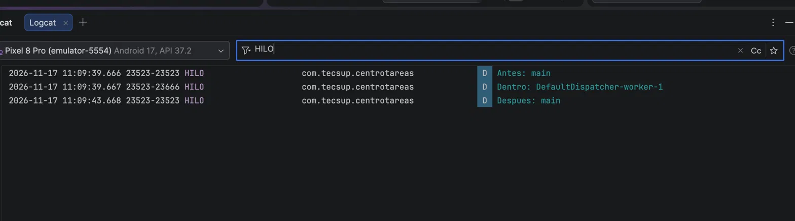
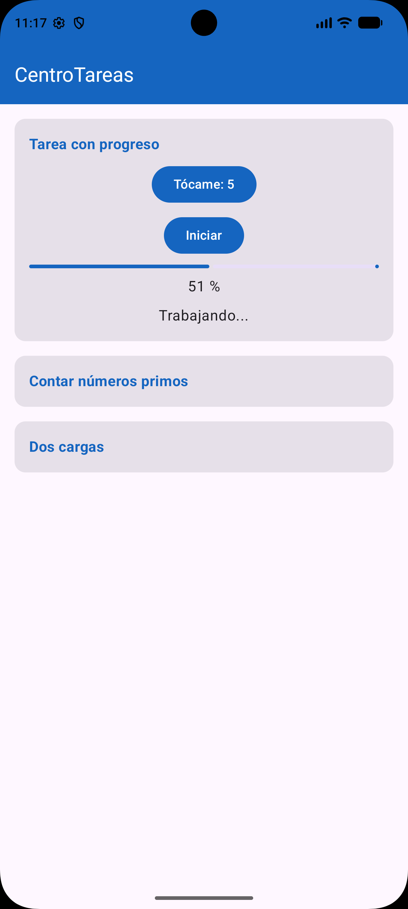
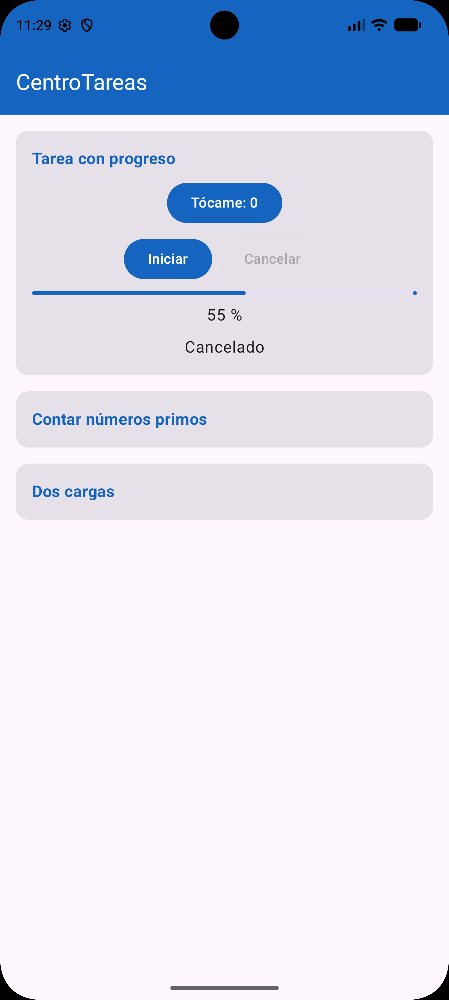
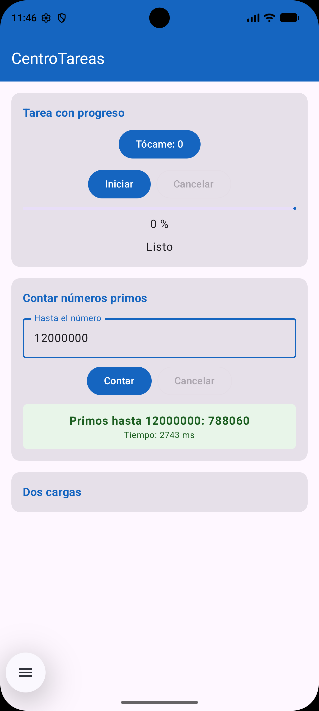
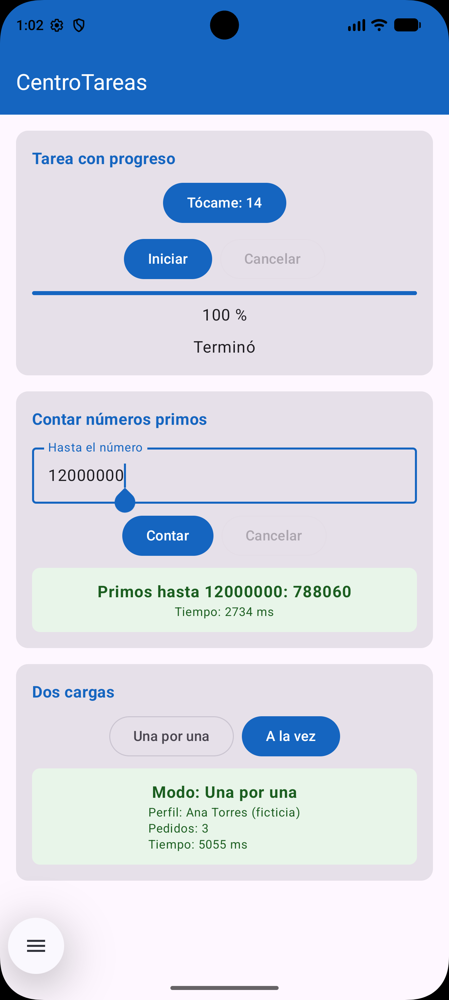
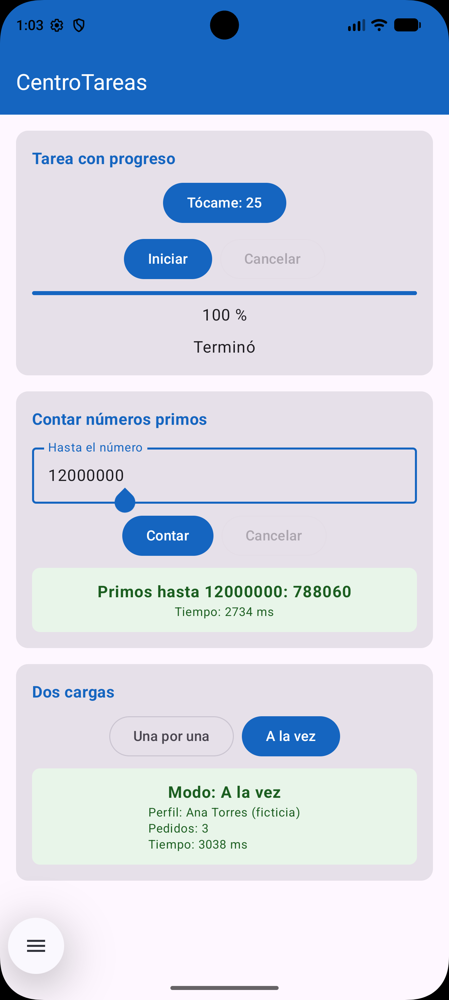
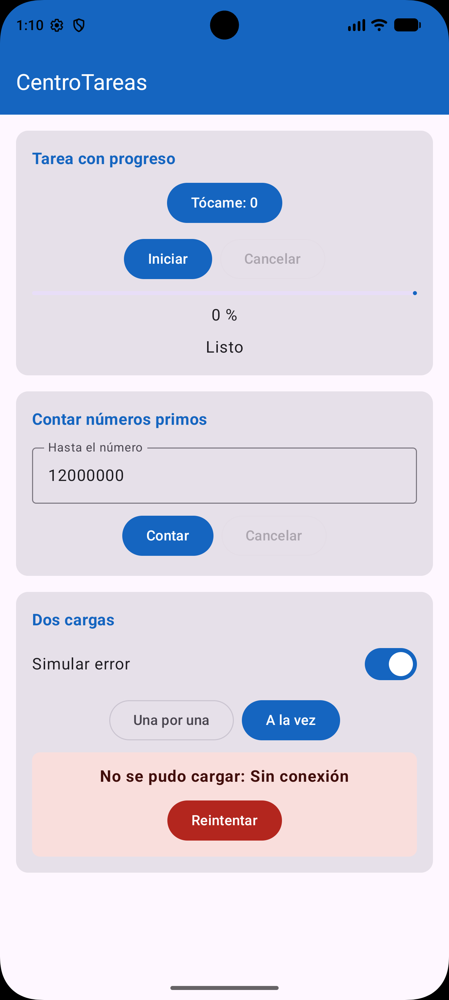
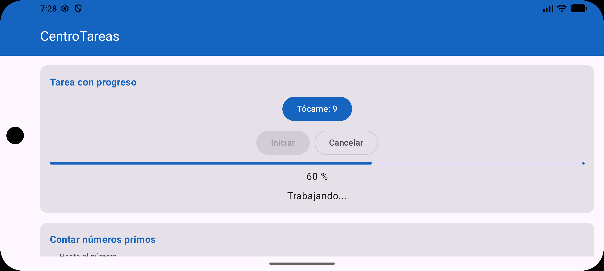

# CentroTareas

**Laboratorio 14 · Hilos en Android** — Programación en Móviles (Tecsup)
Docente: Juan León S. · Alumno: Guillermo Willard Castillo

App que ejecuta tres tareas que tardan (una tarea con barra de progreso, un cálculo pesado de números primos y dos cargas de datos simuladas) sin congelar nunca la pantalla. Primero se provoca el congelamiento con `Thread.sleep` en el hilo principal y luego se resuelve con corrutinas: `viewModelScope`, `withContext`, `Job`, `async` y manejo de errores.

**Tecnologías:** Kotlin · Jetpack Compose · Material 3 · Corrutinas · ViewModel + StateFlow · MVVM + Repository

> **Proyecto base:** no se distribuyó un zip del proyecto base. Se armó con el código de la sección 8 de la guía (`Estados.kt`, `TareasRepository.kt`, `TareasRepositoryLocal.kt` y el esqueleto de `TareasViewModel.kt`) y se completaron los archivos que solo aparecen en el árbol de la sección 6 (`MainActivity.kt`, `TareasViewModelFactory.kt`, `PantallaTareas.kt` y `theme/`).

## Estructura de paquetes

```
com.willard.centrotareas/
├── MainActivity.kt                  Crea el ViewModel con su Factory y muestra la pantalla
├── model/
│   └── Estados.kt                   PrimosUi y CargaUi (sealed interface)
├── data/
│   ├── TareasRepository.kt          Interface
│   └── TareasRepositoryLocal.kt     Cargas simuladas y contarPrimos
├── viewmodel/
│   ├── TareasViewModel.kt           Corrutinas, StateFlow, Job, async y errores
│   └── TareasViewModelFactory.kt    Entrega el Repository al ViewModel
└── ui/
    ├── PantallaTareas.kt            Las tres tarjetas
    └── theme/                       Colores y tema Material 3
```

## Arquitectura MVVM + Repository

```
View (PantallaTareas)
   |  eventos: botones                    ^  collectAsState()
   v                                      |
ViewModel (TareasViewModel) ---- StateFlow ----+
   |  viewModelScope.launch { ... }
   v
TareasRepository (interface) ---> TareasRepositoryLocal
                                  (cargas simuladas y contar primos)
```

| Capa | Conoce a | No hace |
|---|---|---|
| View | Solo a su ViewModel | No lanza corrutinas ni usa `Thread`; solo muestra el estado y avisa los eventos |
| ViewModel | Solo a la interface del Repository | No conoce Composables, no recibe `Context` y no bloquea el hilo principal |
| Repository | Nada de la UI | Sus funciones `suspend` no bloquean el hilo desde el que se llaman |

## Observación del Paso 1

**Qué pasa con la pantalla:** al tocar **Tarea larga (MAL)** y enseguida pulsar **Tócame** varias veces, durante 4 segundos nada responde: el contador no sube y "Trabajando..." nunca llega a verse. Al terminar la espera aparece **Terminó** y el contador salta de golpe al total de toques. Los toques no se perdieron: quedaron en la cola de eventos y el hilo principal los procesó todos juntos al liberarse. Después de eso, el contador vuelve a subir de uno en uno con cada toque.

**Por qué no se ve "Trabajando...":** `Thread.sleep(4000)` bloquea el hilo principal, que es el mismo que dibuja la pantalla y atiende los toques. El mensaje sí cambia a "Trabajando...", pero el hilo no tiene oportunidad de volver a dibujar. Cuando se libera, el mensaje ya vale "Terminó" y solo se dibuja ese último valor.

**Si la espera fuera de 10 segundos:** Android mostraría el diálogo **ANR** ("La app no responde"), porque el hilo principal pasa más de 5 segundos sin atender los eventos del usuario. Ese diálogo da la opción de esperar o cerrar la app.

## Capturas

**Logcat (Paso 2):** `Antes: main`, `Dentro: DefaultDispatcher-worker-1` y `Despues: main`.



| Tarea con progreso (Paso 3) | Cancelada (Paso 4) | Primos (Paso 5) |
|---|---|---|
|  |  |  |

| Una por una ≈ 5 s (Paso 6) | A la vez ≈ 3 s (Paso 6) | Error y Reintentar (Paso 7) |
|---|---|---|
|  |  |  |


**Rotación (Paso 8):** al girar la pantalla a mitad de la tarea, el progreso sigue en 60 %, Tócame conserva su valor y los botones mantienen su estado, porque el estado vive en el ViewModel y el contador usa `rememberSaveable`.



> **Ajuste del valor por defecto de primos:** la guía pide que el cálculo tarde entre 2 y 5 s. En el emulador usado (Pixel 8 Pro, API 37), 500 000 tardaba 170 ms y 4 000 000 tardaba 1084 ms, así que el valor por defecto se subió a **12 000 000** (788 060 primos, ≈ 2,7 s).

## Pruebas de aceptación

| Prueba | Resultado esperado | OK |
|---|---|---|
| Tarea larga: tocar Tócame mientras trabaja | El contador sigue sumando | ✅ |
| Logcat con filtro HILO | `main` antes y después; `DefaultDispatcher-worker` dentro | ✅ |
| Iniciar la tarea con progreso | La barra avanza de 0 a 100 % en ≈ 4 s | ✅ |
| Cancelar a mitad | La barra se detiene, dice Cancelado y se puede iniciar otra vez | ✅ |
| Pulsar Iniciar dos veces seguidas | No se lanzan dos tareas (el botón está deshabilitado) | ✅ |
| Primos hasta 1000 | Resultado 168 | ✅ |
| Primos con N grande | La pantalla no se congela y Cancelar funciona | ✅ |
| Una por una | ≈ 5 s y resultado correcto | ✅ |
| A la vez | ≈ 3 s y resultado correcto | ✅ |
| Error simulado + Reintentar | Recuadro rojo; al desactivar el interruptor y reintentar, éxito | ✅ |
| Rotar la pantalla durante la tarea | La tarea continúa y el progreso no se reinicia | ✅ |
| Revisar el código | `git grep` no encuentra `GlobalScope`, `runBlocking` ni `Thread.sleep` en el código final | ✅ |

```
git grep -n -E "GlobalScope|runBlocking|Thread\.sleep" -- '*.kt'
```

## Para pensar

**1. ¿Por qué no se veía Trabajando... en el Paso 1?**
Porque `Thread.sleep` bloqueó el hilo principal, que es el único que dibuja la pantalla. El valor cambió a "Trabajando...", pero no hubo ningún dibujo mientras el hilo dormía. Cuando despertó, el valor ya era "Terminó".

**2. ¿Qué diferencia hay entre Thread.sleep y delay?**
`Thread.sleep` bloquea el hilo completo: nadie más puede usarlo mientras espera y no se puede cancelar. `delay` suspende solo la corrutina y libera el hilo para otros trabajos, como dibujar o atender toques. Además, `delay` revisa la cancelación, así que se detiene si se cancela el `Job`.

**3. ¿Por qué Dispatchers.Default para los primos y Dispatchers.IO para la red?**
Contar primos usa el procesador todo el tiempo. `Default` tiene tantos hilos como núcleos tiene el CPU, que es lo justo para cálculo. La red o el disco pasan casi todo el tiempo esperando una respuesta sin usar el CPU. `IO` tiene un grupo de hilos más grande, pensado para muchas esperas a la vez.

**4. ¿Qué pasaría con la corrutina si el usuario cierra la pantalla? ¿Qué papel cumple viewModelScope?**
`viewModelScope` está atado a la vida del ViewModel. Si el usuario sale de la pantalla y el ViewModel se destruye (`onCleared`), el scope cancela automáticamente todas sus corrutinas, sin fugas de memoria ni trabajo inútil. En cambio, al rotar, el ViewModel sobrevive y la corrutina sigue corriendo; por eso el progreso no se reinicia.

**5. ¿Por qué async tarda 3 s y no 5 s? ¿Qué pasa si una de las dos cargas falla?**
Con `async`, las dos cargas empiezan al mismo tiempo y `await()` espera a ambas, así que el total es lo que tarda la más lenta: máx(2 s, 3 s) ≈ 3 s. Una por una, en cambio, suma 2 s + 3 s ≈ 5 s. Si una falla, `coroutineScope` cancela la otra y relanza la excepción. El `try/catch` del ViewModel la atrapa y muestra el estado de error con el botón Reintentar, sin que la app se cierre.

## Guía de sustentación

| Concepto | Dónde está |
|---|---|
| Corrutina con `viewModelScope.launch` | `viewmodel/TareasViewModel.kt:38` |
| Cambio de hilo con `withContext(Dispatchers.Default)` | `viewmodel/TareasViewModel.kt:43` |
| Evitar doble inicio | `viewmodel/TareasViewModel.kt:36` |
| `finally` que libera `corriendo` | `viewmodel/TareasViewModel.kt:52` |
| Cancelar con `Job` | `viewmodel/TareasViewModel.kt:58` |
| Cálculo pesado en `Dispatchers.Default` | `data/TareasRepositoryLocal.kt:22` |
| `ensureActive()` para cancelar a mitad del ciclo | `data/TareasRepositoryLocal.kt:25` |
| `esPrimo` sin desborde (`d.toLong() * d <= n`) | `data/TareasRepositoryLocal.kt:34` |
| Relanzar la `CancellationException` | `viewmodel/TareasViewModel.kt:78-80` |
| Carga en paralelo con `async` + `coroutineScope` | `viewmodel/TareasViewModel.kt:124-127` |
| Manejo de errores (`catch` doble) | `viewmodel/TareasViewModel.kt:131-133` |
| Error simulado | `data/TareasRepositoryLocal.kt:18` |
| La vista observa el estado con `collectAsState()` | `ui/PantallaTareas.kt:50-55` |
| Botones habilitados según el estado | `ui/PantallaTareas.kt:91`, `:97` |
| Reintentar | `ui/PantallaTareas.kt:186` |

## Cómo ejecutar

1. Clonar el repositorio y abrirlo en Android Studio.
2. Sincronizar Gradle.
3. Ejecutar en un emulador o dispositivo con Android 7.0 (API 24) o superior.

No necesita internet ni permisos: las cargas se simulan con `delay`.